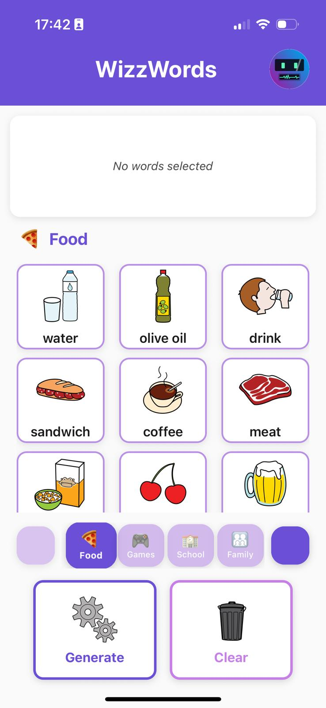
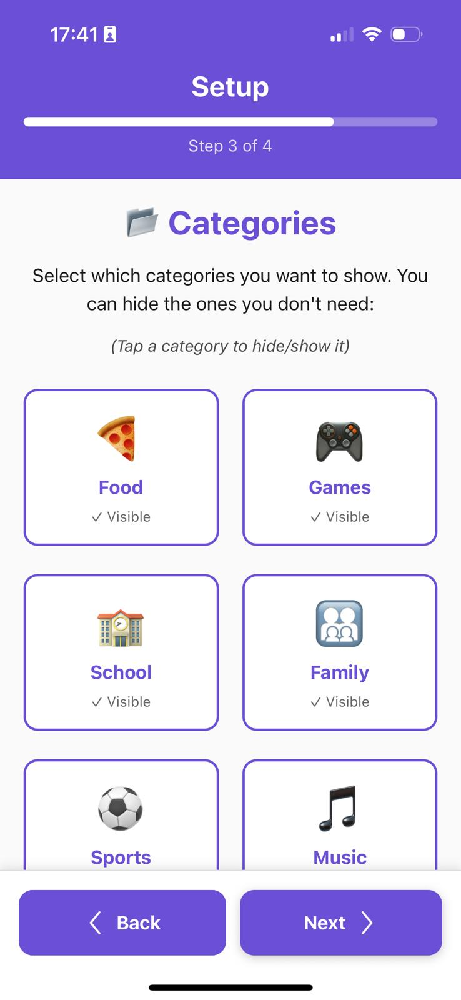
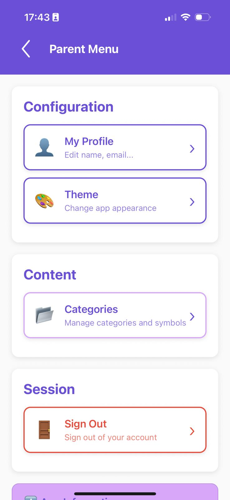
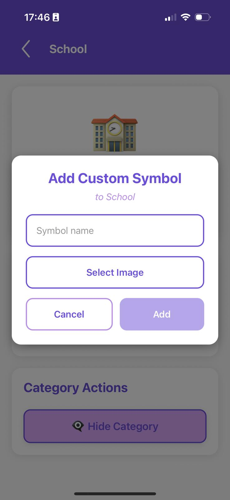

<p align="center">
  
</p>

<h1 align="center">WizzWords</h1>

<p align="center">
  <strong>An AAC app that helps children with communication difficulties express themselves through ARASAAC pictograms, AI-generated phrases and text-to-speech.</strong>
</p>

<p align="center">
  
  
  
  
  
  
</p>

<p align="center">
  <a href="#-about">About</a> •
  <a href="#-demo">Demo</a> •
  <a href="#-screenshots">Screenshots</a> •
  <a href="#-features">Features</a> •
  <a href="#-tech-stack">Tech stack</a> •
  <a href="#-architecture">Architecture</a> •
  <a href="#-getting-started">Getting started</a>
</p>

---

## 📖 About

Children who cannot rely on speech need a simple way to build and voice everyday messages. **WizzWords** is a mobile Augmentative and Alternative Communication (AAC) app for that purpose.

The child browses pictogram categories, selects symbols on a communication board and generates short, natural phrases. Those phrases appear as flashcards with an AI-generated illustration and can be spoken aloud with text-to-speech. Phrase wording is adjusted to the child's age when it has been set. A password-protected parent menu lets caregivers manage themes, categories, custom symbols and the child's profile.

### 🎯 Objectives

- **Generate** natural-language phrases from selected PCS symbols and show them as flashcards with an image and audio.
- **Adapt** to each child's profile and preferences (themes, categories and parent controls).
- **Provide** an accessible, easy-to-use interface with large touch targets and high-contrast color palettes.

## 🎥 Demo


https://github.com/user-attachments/assets/af3dac12-67ab-4113-a6b4-06d8a4551faa


## 📱 Screenshots

<table>
  <tr>
    <td align="center" width="25%">
      <br>
      <sub>Communication board</sub>
    </td>
    <td align="center" width="25%">
      <br>
      <sub>Setup: categories</sub>
    </td>
    <td align="center" width="25%">
      <br>
      <sub>Parent menu</sub>
    </td>
    <td align="center" width="25%">
      <br>
      <sub>Add custom symbol</sub>
    </td>
  </tr>
</table>

## ✨ Features

### 🎨 User interface

- Accessible layout with large buttons and high readability
- Six color palettes: Purple Harmony, Ocean Blue, Forest Green, Sunshine Bright, Soft Pastel and Earthy Tones
- Dual mode: a communication board for the child and a menu for parents or caregivers
- In-app toast notifications

### 🖼️ ARASAAC pictograms

- ARASAAC pictogram library, loaded through the backend
- Predefined categories: Food, Games, School, Family, Sports, Music, Animals and Transport
- Custom categories (empty, or filled with standard PCS symbols from a description), with the option to hide or show them
- Custom symbols added from the photo library

### 🤖 Artificial intelligence

- Natural phrase generation from selected symbols with Azure OpenAI (three child-friendly phrases, with language adapted to the child's age when it is set)
- AI-generated flashcard images (DALL·E 3 via the backend)
- **Generate More** adds one extra phrase variant

### 🔊 Text-to-speech

- Voice playback with Expo Speech
- Tap a flashcard to hear the generated phrase

### 👤 User management

- Firebase Authentication with email and password
- Profiles and preferences stored in Firestore (name, email, child's age, categories)
- Onboarding for new users: child's age, color theme, categories and parent-menu password
- Dicebear avatars

### 🔒 Security and accessibility

- Password-protected parent menu, with a 30-second lockout after 5 failed attempts
- Parent-menu password must be at least 6 characters and cannot be a common weak password
- Accessibility labels on main buttons and navigation for screen readers

## 🛠️ Tech stack

| Layer | Technologies |
|-------|----------------|
| Frontend | React Native 0.81, Expo 54, TypeScript, React Navigation, Expo Speech, Expo Image Picker, AsyncStorage |
| Backend | Node.js, Express, TypeScript |
| Auth and data | Firebase Authentication, Cloud Firestore |
| AI | Azure OpenAI (phrase generation; default deployment `gpt-5-mini`), Azure OpenAI DALL·E 3 (flashcard images) |
| Pictograms | [ARASAAC](https://arasaac.org) (proxied by the backend) |
| Avatars | Dicebear (`botttsNeutral`) |

## 🏛️ Architecture

The Expo app talks to a local Express backend that proxies ARASAAC and Azure OpenAI (avoiding CORS issues on the client). User accounts and preferences live in Firebase.

```
wizzwords-aac-platform/
├── frontend/                 # React Native / Expo app
│   ├── screens/
│   ├── components/
│   ├── services/             # Firebase, API client, ARASAAC helpers
│   ├── context/              # Theme, user, toast
│   ├── types/
│   └── assets/               # App logo and UI assets
├── backend/                  # Express API (TypeScript)
│   ├── index.ts
│   ├── config.ts             # Env and Azure configuration
│   ├── services/             # Phrases, images, ARASAAC, categories, users, avatars
│   └── data/                 # Predefined categories and pictogram data
├── assets/                   # Project-level assets (Polimi logo)
└── README.md
```

The full API reference is in [backend/README.md](backend/README.md).

## 🚀 Getting started

### Prerequisites

- Node.js 18+
- npm
- A Firebase project (Authentication and Firestore)
- An Azure OpenAI resource (required for phrase and image generation)

### Install

```bash
git clone https://github.com/pablojhdcoder/wizzwords-aac-platform.git
cd wizzwords-aac-platform
npm run install:all
```

### Environment variables

There is no `.env.example` in the repository. Create the two files below and fill in your own values.

`frontend/.env`:

```env
EXPO_PUBLIC_API_URL=
EXPO_PUBLIC_FIREBASE_API_KEY=
EXPO_PUBLIC_FIREBASE_AUTH_DOMAIN=
EXPO_PUBLIC_FIREBASE_PROJECT_ID=
EXPO_PUBLIC_FIREBASE_STORAGE_BUCKET=
EXPO_PUBLIC_FIREBASE_MESSAGING_SENDER_ID=
EXPO_PUBLIC_FIREBASE_APP_ID=
EXPO_PUBLIC_FIREBASE_MEASUREMENT_ID=
```

`EXPO_PUBLIC_FIREBASE_MEASUREMENT_ID` is optional (Firebase Analytics). `EXPO_PUBLIC_API_URL` defaults to `http://localhost:3000` if omitted.

Set `EXPO_PUBLIC_API_URL` according to where you run the app:

- iOS Simulator or web: `http://localhost:3000`
- Android emulator: `http://10.0.2.2:3000`
- Physical device: `http://YOUR_LOCAL_IP:3000`

`backend/.env`:

```env
PORT=
AZURE_OPENAI_PHRASE_URL=
AZURE_OPENAI_PHRASE_KEY=
AZURE_OPENAI_PHRASE_DEPLOYMENT=
AZURE_OPENAI_IMAGE_ENDPOINT=
AZURE_OPENAI_IMAGE_API_KEY=
```

`PORT` defaults to `3000`. `AZURE_OPENAI_PHRASE_DEPLOYMENT` defaults to `gpt-5-mini`. Image variables are required for flashcard illustrations.

### Run

In two terminals, from the repository root:

```bash
npm run server
```

```bash
npm start
```

`npm run server` starts the backend with `ts-node`. `npm start` starts the Expo dev server. For auto-reload on the backend, use `npm run server:dev`. To open a specific platform: `npm run frontend:android`, `npm run frontend:ios`, or `npm run frontend:web`.

## 🙏 Credits

Pictograms are from [ARASAAC](https://arasaac.org) and are used under the [Creative Commons BY-NC-SA](https://arasaac.org/terms-of-use) license.

The pictographic symbols used are the property of the Government of Aragón and have been created by Sergio Palao for ARASAAC (http://www.arasaac.org), that distributes them under Creative Commons License BY-NC-SA.

## 👥 Authors

Academic prototype developed for the **Advanced User Interfaces** course at Politecnico di Milano.

<p align="center">
  
</p>

| Author | Contact |
|--------|---------|
| Massimo Bakker | [mwgbakker@student.tudelft.nl](mailto:mwgbakker@student.tudelft.nl) |
| Pablo Jesús Herrero Díaz | [pablojesus.herrero@mail.polimi.it](mailto:pablojesus.herrero@mail.polimi.it) |
| José Martínez Estévez | [jose3.martinez@mail.polimi.it](mailto:jose3.martinez@mail.polimi.it) |

## 📄 License

MIT — see [LICENSE](LICENSE).
